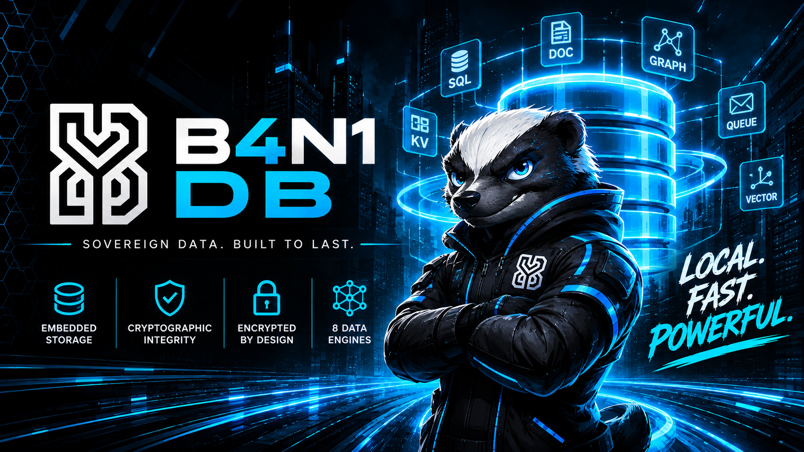

<div align="center">



</div>

# b4n1-db

**طبقة بيانات سيادية مضمّنة لنظام B4N1 البيئي.** مقبض واحد (`SovereignDB`) فوق
ثمانية محركات تخزين محلية — بلا قاعدة بيانات عميل/خادم، بلا محرك شبكة، بلا خادم
خفي (daemon)، بلا تبعيات خارجية.

> **الحالة: مكتبة + ملف تنفيذي مستقل.** توفّر مكتبة أصلية وأداة سطر أوامر مستقلة
> `b4n1-db` (KV، SQL، الرسوم البيانية، المستندات، قوائم الانتظار، المتجهات، التدقيق،
> الترحيلات، النقل، بالإضافة إلى `demo` دون اتصال و`docs`). بلا خادم MCP. حزم SDK
> المنشورة: PyPI، npm، NuGet، RubyGems، Packagist وGo modules (انظر `sdks/`).

**اللغات:** [العربية](README.ar.md) · [Deutsch](README.de.md) · [Español](README.es.md) · [Français](README.fr.md) · [हिन्दी](README.hi.md) · [Italiano](README.it.md) · [日本語](README.ja.md) · [한국어](README.ko.md) · [Português (BR)](README.pt-BR.md) · [Русский](README.ru.md) · [中文](README.zh-CN.md)

---

## المحتويات

- [ما هو](#ما-هو)
- [التثبيت](#التثبيت)
- [البدء السريع](#البدء-السريع)
- [الأنظمة الفرعية](#الأنظمة-الفرعية)
- [حزم SDK](#حزم-sdk)
- [الترخيص](#الترخيص)

---

## ما هو

`b4n1-db` طبقة بيانات مضمّنة متعددة المحركات. تفتح مجلدًا فتحصل على مقبض واحد
يكشف ثمانية محركات تخزين، جميعها محلية وحتمية وقابلة للتدقيق.

| المحرك | الوظيفة |
|--------|---------|
| KV | مفتاح/قيمة مع TTL، عدّادات ذرّية، CAS |
| SQL | SQL تحليلي فوق تخزين عمودي |
| Graph | رسم بياني للمعرفة مع بحث هجين |
| Doc | مجموعات مستندات مع استعلامات حسب الحقل |
| Queue | قوائم FIFO مع ack/nack |
| Vector | فهرس متجهات بتماثل جيبي |
| Audit | سجل تدقيق Merkle-DAG مع السفر عبر الزمن |
| Migration | سجل ترحيلات المخطط |

بلا خادم خفي. بلا شبكة. بلا قاعدة بيانات خارجية.

## التثبيت

### Python
```bash
pip install b4n1-db
```

### Node.js
```bash
npm install b4n1-db
```

### .NET
```bash
dotnet add package B4n1.Db
```

### Ruby
```bash
gem install b4n1-db
```

### PHP (Composer)
```bash
composer require b4n1/b4n1-db
```

### Go
```bash
go get github.com/B4N1-com/b4n1-db/sdks/go
```

## البدء السريع

```bash
b4n1-db kv put mydb greeting "hello"
b4n1-db kv get mydb greeting
b4n1-db sql query mydb "SELECT * FROM users WHERE age > 25"
b4n1-db demo
b4n1-db docs
b4n1-db --licenses
```

## الأنظمة الفرعية

| الأمر | الوصف |
|-------|-------|
| `kv` | مخزن مفتاح/قيمة: put, get, delete, scan, TTL |
| `sql` | محرك SQL تحليلي |
| `graph` | رسم بياني للمعرفة وبحث هجين |
| `doc` | مجموعات مستندات |
| `queue` | قوائم FIFO مع ack/nack |
| `vector` | فهرس متجهات بتماثل جيبي |
| `audit` | سجل تدقيق Merkle-DAG |
| `migration` | سجل ترحيلات المخطط |
| `transfer` | النسخ الاحتياطي والاستعادة ونقل JSON |
| `demo` | عرض توضيحي بلا اتصال بنقرة واحدة |
| `docs` | توثيق مضمّن |

## حزم SDK

مجلد `sdks/` يحتوي على أغلفة رقيقة لسبع لغات. كل SDK يضمّن الملف التنفيذي الأصلي
ويحلّه بهذا الترتيب: `B4N1_DB_BIN` → `bin/` المضمّن → `PATH`.

| SDK | المجلد | الحزمة |
|-----|--------|--------|
| Python | `sdks/python/` | PyPI: `b4n1-db` |
| Node.js | `sdks/node/` | npm: `b4n1-db` |
| .NET | `sdks/cs/` | NuGet: `B4n1.Db` |
| Ruby | `sdks/ruby/` | RubyGems: `b4n1-db` |
| PHP | `sdks/php/` | Packagist: `b4n1/b4n1-db` |
| Go | `sdks/go/` | Go modules |
| Java | `sdks/java/` | (Maven قيد الانتظار) |

## الترخيص

Business Source License 1.1 (BUSL-1.1). انظر [LICENSE](../LICENSE) و[EULA.txt](../EULA.txt).

---

*جزء من [نظام B4N1 البيئي](https://b4n1.com).*
