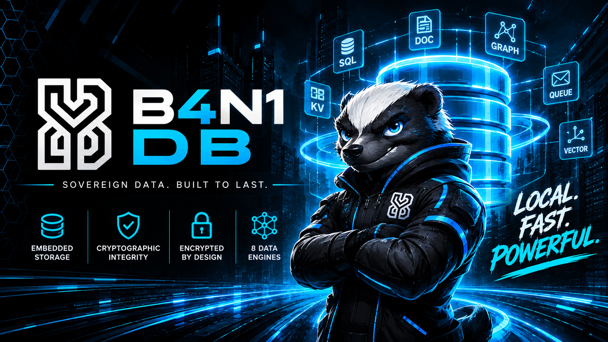

<div align="center">



</div>

# b4n1-db

**Couche de données souveraine embarquée pour l'écosystème B4N1.** Un seul handle
(`SovereignDB`) sur huit moteurs de stockage locaux — pas de base client/serveur,
pas de moteur réseau, pas de démon, aucune dépendance externe.

> **Statut : bibliothèque + binaire autonome.** Fournit une bibliothèque native ET
> un CLI autonome `b4n1-db` (KV, SQL, graphe, documents, files, vecteurs, audit,
> migrations, transfert, plus un `demo` hors ligne et `docs`). Pas de serveur MCP.
> SDK publiés : PyPI, npm, NuGet, RubyGems, Packagist et Go modules (voir `sdks/`).

**Langues :** [العربية](README.ar.md) · [Deutsch](README.de.md) · [Español](README.es.md) · [Français](README.fr.md) · [हिन्दी](README.hi.md) · [Italiano](README.it.md) · [日本語](README.ja.md) · [한국어](README.ko.md) · [Português (BR)](README.pt-BR.md) · [Русский](README.ru.md) · [中文](README.zh-CN.md)

---

## Table des matières

- [Qu'est-ce que c'est](#quest-ce-que-cest)
- [Installation](#installation)
- [Démarrage rapide](#démarrage-rapide)
- [Sous-systèmes](#sous-systèmes)
- [SDKs](#sdks)
- [Licence](#licence)

---

## Qu'est-ce que c'est

`b4n1-db` est une couche de données embarquée multi-moteurs. Vous ouvrez un
répertoire et obtenez un handle unique exposant huit moteurs de stockage, tous
locaux, déterministes et auditables.

| Moteur | Fonction |
|--------|----------|
| KV | Clé/valeur avec TTL, compteurs atomiques, CAS |
| SQL | SQL analytique sur stockage en colonnes |
| Graph | Graphe de connaissances avec recherche hybride |
| Doc | Collections de documents avec requêtes par champ |
| Queue | Files FIFO avec ack/nack |
| Vector | Index vectoriel avec similarité cosinus |
| Audit | Journal d'audit Merkle-DAG avec voyage dans le temps |
| Migration | Registre de migrations de schéma |

Pas de démon. Pas de réseau. Pas de base externe.

## Installation

### Python
```bash
pip install b4n1-db
```

### Node.js
```bash
npm install b4n1-db
```

### .NET
```bash
dotnet add package B4n1.Db
```

### Ruby
```bash
gem install b4n1-db
```

### PHP (Composer)
```bash
composer require b4n1/b4n1-db
```

### Go
```bash
go get github.com/B4N1-com/b4n1-db/sdks/go
```

## Démarrage rapide

```bash
b4n1-db kv put mydb greeting "hello"
b4n1-db kv get mydb greeting
b4n1-db sql query mydb "SELECT * FROM users WHERE age > 25"
b4n1-db demo
b4n1-db docs
b4n1-db --licenses
```

## Sous-systèmes

| Verbe | Description |
|-------|-------------|
| `kv` | Clé/valeur : put, get, delete, scan, TTL |
| `sql` | Moteur SQL analytique |
| `graph` | Graphe de connaissances et recherche hybride |
| `doc` | Collections de documents |
| `queue` | Files FIFO avec ack/nack |
| `vector` | Index vectoriel avec similarité cosinus |
| `audit` | Journal d'audit Merkle-DAG |
| `migration` | Registre de migrations de schéma |
| `transfer` | Sauvegarde, restauration et transfert JSON |
| `demo` | Démonstration hors ligne en 1 clic |
| `docs` | Documentation intégrée |

## SDKs

Le dossier `sdks/` contient des wrappers légers pour 7 langages. Chaque SDK
embarque le binaire natif et le résout dans cet ordre : `B4N1_DB_BIN` →
`bin/` embarqué → `PATH`.

| SDK | Dossier | Paquet |
|-----|---------|--------|
| Python | `sdks/python/` | PyPI : `b4n1-db` |
| Node.js | `sdks/node/` | npm : `b4n1-db` |
| .NET | `sdks/cs/` | NuGet : `B4n1.Db` |
| Ruby | `sdks/ruby/` | RubyGems : `b4n1-db` |
| PHP | `sdks/php/` | Packagist : `b4n1/b4n1-db` |
| Go | `sdks/go/` | Go modules |
| Java | `sdks/java/` | (Maven en attente) |

## Licence

Business Source License 1.1 (BUSL-1.1). Voir [LICENSE](../LICENSE) et [EULA.txt](../EULA.txt).

---

*Fait partie de l'[écosystème B4N1](https://b4n1.com).*
