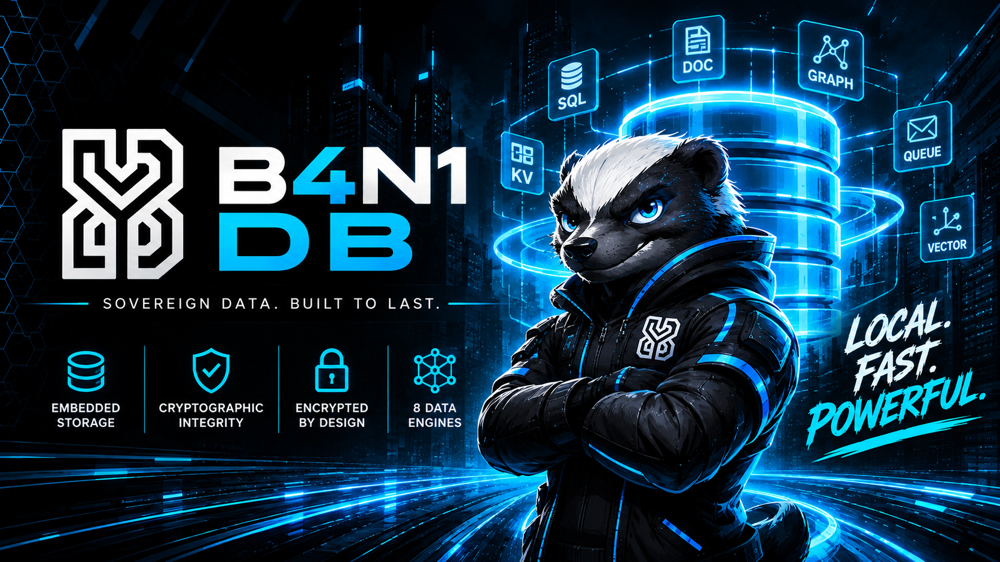

<div align="center">



</div>

# b4n1-db

**B4N1 エコシステム向けのソブリン組込みデータ層。** 単一のハンドル
（`SovereignDB`）で 8 つのローカルストレージエンジンを操作できます。クライアント/
サーバー型データベース、ネットワークエンジン、デーモン、外部依存は一切ありません。

> **ステータス：ライブラリ + スタンドアロンバイナリ。** ネイティブライブラリと
> スタンドアロン CLI `b4n1-db`（KV、SQL、グラフ、ドキュメント、キュー、ベクトル、
> 監査、マイグレーション、転送、さらにオフラインの `demo` と `docs`）を提供します。
> MCP サーバーはありません。公開 SDK：PyPI、npm、NuGet、RubyGems、Packagist、
> Go modules（`sdks/` を参照）。

**言語：** [العربية](README.ar.md) · [Deutsch](README.de.md) · [Español](README.es.md) · [Français](README.fr.md) · [हिन्दी](README.hi.md) · [Italiano](README.it.md) · [日本語](README.ja.md) · [한국어](README.ko.md) · [Português (BR)](README.pt-BR.md) · [Русский](README.ru.md) · [中文](README.zh-CN.md)

---

## 目次

- [概要](#概要)
- [インストール](#インストール)
- [クイックスタート](#クイックスタート)
- [サブシステム](#サブシステム)
- [SDK](#sdk)
- [ライセンス](#ライセンス)

---

## 概要

`b4n1-db` は組込み型のマルチエンジンデータ層です。ディレクトリを開くと、8 つの
ストレージエンジンを公開する単一のハンドルが得られます。すべてローカルで決定的、
そして監査可能です。

| エンジン | 機能 |
|----------|------|
| KV | TTL 付きキー/バリュー、アトミックカウンタ、CAS |
| SQL | 列指向ストレージ上の分析用 SQL |
| Graph | ハイブリッド検索付きナレッジグラフ |
| Doc | フィールドクエリ付きドキュメントコレクション |
| Queue | ack/nack 付き FIFO キュー |
| Vector | コサイン類似度のベクトルインデックス |
| Audit | タイムトラベル付き Merkle-DAG 監査ログ |
| Migration | スキーママイグレーション登録簿 |

デーモンなし。ネットワークなし。外部データベースなし。

## インストール

### Python
```bash
pip install b4n1-db
```

### Node.js
```bash
npm install b4n1-db
```

### .NET
```bash
dotnet add package B4n1.Db
```

### Ruby
```bash
gem install b4n1-db
```

### PHP (Composer)
```bash
composer require b4n1/b4n1-db
```

### Go
```bash
go get github.com/B4N1-com/b4n1-db/sdks/go
```

## クイックスタート

```bash
b4n1-db kv put mydb greeting "hello"
b4n1-db kv get mydb greeting
b4n1-db sql query mydb "SELECT * FROM users WHERE age > 25"
b4n1-db demo
b4n1-db docs
b4n1-db --licenses
```

## サブシステム

| コマンド | 説明 |
|----------|------|
| `kv` | キー/バリュー：put、get、delete、scan、TTL |
| `sql` | 分析用 SQL エンジン |
| `graph` | ナレッジグラフとハイブリッド検索 |
| `doc` | ドキュメントコレクション |
| `queue` | ack/nack 付き FIFO キュー |
| `vector` | コサイン類似度のベクトルインデックス |
| `audit` | Merkle-DAG 監査ログ |
| `migration` | スキーママイグレーション登録簿 |
| `transfer` | バックアップ、リストア、JSON 転送 |
| `demo` | ワンクリックのオフラインデモ |
| `docs` | 組込みドキュメント |

## SDK

`sdks/` ディレクトリには 7 言語の薄いラッパーがあります。各 SDK はネイティブ
バイナリを同梱し、次の順序で解決します：`B4N1_DB_BIN` → 同梱 `bin/` → `PATH`。

| SDK | ディレクトリ | パッケージ |
|-----|-------------|-----------|
| Python | `sdks/python/` | PyPI：`b4n1-db` |
| Node.js | `sdks/node/` | npm：`b4n1-db` |
| .NET | `sdks/cs/` | NuGet：`B4n1.Db` |
| Ruby | `sdks/ruby/` | RubyGems：`b4n1-db` |
| PHP | `sdks/php/` | Packagist：`b4n1/b4n1-db` |
| Go | `sdks/go/` | Go modules |
| Java | `sdks/java/` | （Maven 保留中） |

## ライセンス

Business Source License 1.1（BUSL-1.1）。[LICENSE](../LICENSE) と [EULA.txt](../EULA.txt) を参照。

---

*[B4N1 エコシステム](https://b4n1.com) の一部。*
