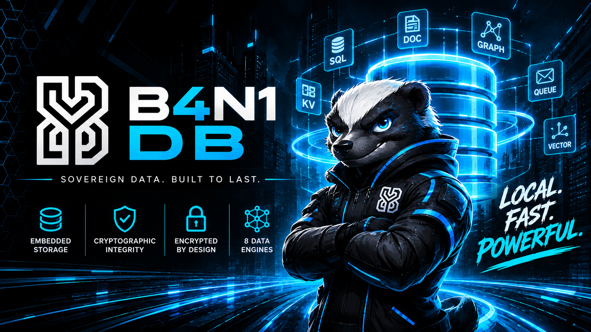

<div align="center">



</div>

# b4n1-db

**B4N1 생태계를 위한 소버린 임베디드 데이터 계층.** 단일 핸들(`SovereignDB`)로
8개의 로컬 스토리지 엔진을 다룹니다. 클라이언트/서버 데이터베이스도, 네트워크
엔진도, 데몬도, 외부 의존성도 없습니다.

> **상태: 라이브러리 + 독립 실행 바이너리.** 네이티브 라이브러리와 독립 실행형
> `b4n1-db` CLI(KV, SQL, 그래프, 문서, 큐, 벡터, 감사, 마이그레이션, 전송, 그리고
> 오프라인 `demo`와 `docs`)를 제공합니다. MCP 서버 없음. 게시된 SDK: PyPI, npm,
> NuGet, RubyGems, Packagist, Go modules (`sdks/` 참조).

**언어:** [العربية](README.ar.md) · [Deutsch](README.de.md) · [Español](README.es.md) · [Français](README.fr.md) · [हिन्दी](README.hi.md) · [Italiano](README.it.md) · [日本語](README.ja.md) · [한국어](README.ko.md) · [Português (BR)](README.pt-BR.md) · [Русский](README.ru.md) · [中文](README.zh-CN.md)

---

## 목차

- [개요](#개요)
- [설치](#설치)
- [빠른 시작](#빠른-시작)
- [하위 시스템](#하위-시스템)
- [SDK](#sdk)
- [라이선스](#라이선스)

---

## 개요

`b4n1-db`는 임베디드 멀티 엔진 데이터 계층입니다. 디렉터리를 열면 8개의 스토리지
엔진을 노출하는 단일 핸들을 얻습니다. 모두 로컬이고 결정적이며 감사 가능합니다.

| 엔진 | 기능 |
|------|------|
| KV | TTL이 있는 키/값, 원자 카운터, CAS |
| SQL | 컬럼 기반 스토리지 위의 분석 SQL |
| Graph | 하이브리드 검색을 갖춘 지식 그래프 |
| Doc | 필드 쿼리를 지원하는 문서 컬렉션 |
| Queue | ack/nack이 있는 FIFO 큐 |
| Vector | 코사인 유사도 벡터 인덱스 |
| Audit | 시간 여행이 가능한 Merkle-DAG 감사 로그 |
| Migration | 스키마 마이그레이션 레지스트리 |

데몬 없음. 네트워크 없음. 외부 데이터베이스 없음.

## 설치

### Python
```bash
pip install b4n1-db
```

### Node.js
```bash
npm install b4n1-db
```

### .NET
```bash
dotnet add package B4n1.Db
```

### Ruby
```bash
gem install b4n1-db
```

### PHP (Composer)
```bash
composer require b4n1/b4n1-db
```

### Go
```bash
go get github.com/B4N1-com/b4n1-db/sdks/go
```

## 빠른 시작

```bash
b4n1-db kv put mydb greeting "hello"
b4n1-db kv get mydb greeting
b4n1-db sql query mydb "SELECT * FROM users WHERE age > 25"
b4n1-db demo
b4n1-db docs
b4n1-db --licenses
```

## 하위 시스템

| 명령 | 설명 |
|------|------|
| `kv` | 키/값 저장소: put, get, delete, scan, TTL |
| `sql` | 분석 SQL 엔진 |
| `graph` | 지식 그래프와 하이브리드 검색 |
| `doc` | 문서 컬렉션 |
| `queue` | ack/nack이 있는 FIFO 큐 |
| `vector` | 코사인 유사도 벡터 인덱스 |
| `audit` | Merkle-DAG 감사 로그 |
| `migration` | 스키마 마이그레이션 레지스트리 |
| `transfer` | 백업, 복원, JSON 전송 |
| `demo` | 원클릭 오프라인 데모 |
| `docs` | 내장 문서 |

## SDK

`sdks/` 디렉터리에는 7개 언어용 얇은 래퍼가 있습니다. 각 SDK는 네이티브
바이너리를 내장하고 다음 순서로 해석합니다: `B4N1_DB_BIN` → 내장 `bin/` → `PATH`.

| SDK | 디렉터리 | 패키지 |
|-----|----------|--------|
| Python | `sdks/python/` | PyPI: `b4n1-db` |
| Node.js | `sdks/node/` | npm: `b4n1-db` |
| .NET | `sdks/cs/` | NuGet: `B4n1.Db` |
| Ruby | `sdks/ruby/` | RubyGems: `b4n1-db` |
| PHP | `sdks/php/` | Packagist: `b4n1/b4n1-db` |
| Go | `sdks/go/` | Go modules |
| Java | `sdks/java/` | (Maven 보류) |

## 라이선스

Business Source License 1.1 (BUSL-1.1). [LICENSE](../LICENSE) 및 [EULA.txt](../EULA.txt) 참조.

---

*[B4N1 생태계](https://b4n1.com)의 일부.*
